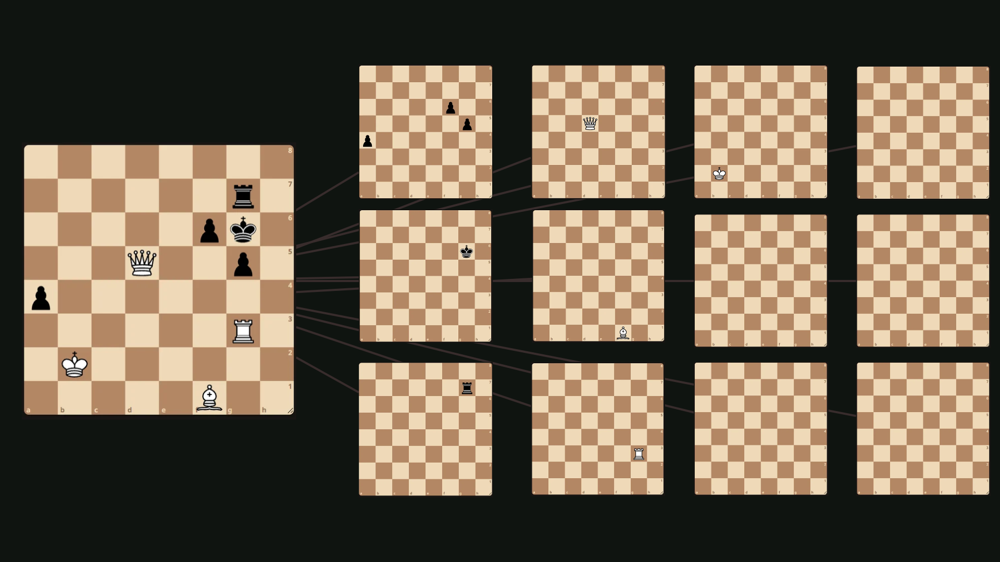

## Chess AI - a PyTorch model trained on the Lichess public database

Traditional chess engines are pretty cool. They...

- Evaluate the position
- Generate every legal move
- Search recursively to a given depth

...and beat every chess player on planet Earth.

What if we apply Machine Learning to this?
Well, we get a dumber engine (at least, in my case), but a cool project.

## How it works

A chess position fed to the model is first decomposed into 12 boards (one for each piece type and color). It also includes a single turn variable (1 for white, 0 for black). Then everything gets flattened into a 1D tensor with 769 values.


<i>Can you find the mate in 3? (White to move, answer at the bottom)</i>

The model returns a 32 element 1D tensor. This is an encoded UCI style move (e2e4, d2d4, ...), split into four groups of 8 elements:

- Elements 0-7: the start column (a-h)
- Elements 8-15: the start row (1-8)
- Elements 16-23: the destination column (a-h)
- Elements 24-31: the destination row (1-8)

Each group of 8 acts like a one-hot vector, so the highest value in the group selects the column or row. For example, `e2e4` is decoded as start column `e`, start row `2`, destination column `e` and destination row `4`.

The four selected values are then combined into a UCI string, which is converted to a move and applied to the board.

## Current results

Not great, but not nothing either. After training on a small portion of the dataset for 1000 epochs, this is a game I got (both sides being played by the model):

```
1. e4 e5
2. Nf3 Nc6
3. Bc4 Nf6
4. d3 Bf8-e6 (illegal)
5. Bc1-c3 (illegal) b6
```

Another game (with some tweaked model params, and a smaller number of epochs):

```
1. e4 e5
2. Nf3 Nc6
3. Bc4 Nf6
4. d3 f7-e6 (illegal)
5. O-O Bc5
```

If you have a keen eye, you might have noticed that the model made 2 illegal moves in the first 5 moves of the first game... I'm working on experimenting with fixes for that soon :p

## Future plans

Currently, the first 2-3 moves played by the engine are perfect. Because it saw those specific positions so many times, it memorized them. After that, the model produces illegal moves almost immediately.

Ideas for improving the model:

- Mask illegal moves at inference time, using the legal move list from the bulletchess library to filter the model's output and pick the highest-scoring legal move.
- Stop flattening the inputs and use a Conv2D layer instead, so the model can pick up spatial patterns more easily. (Slightly challenging because of the lone turn input: it could be added as an extra constant channel of 1s or 0s.)
- Add an interactive test where you can play against the model in a pywebview window, instead of just seeing how it plays against itself

## Training dataset

This project uses [Lichess.org's open database](https://database.lichess.org/), specifically the earliest data dump from January 2013, which contains around 121k games.

## Contributing

Contributions are greatly appreciated! I can't promise the codebase makes much sense, since this is just a weekend experiment. But if you want to untangle whatever I wrote, go for it!

## Trying it yourself

<i>This project is still in development, more features and model improvements are soon to come!</i>

Dependencies:
-  [NumPy](https://numpy.org/)
-  [PyTorch](https://pytorch.org/) - model building and training
-  [requests](https://requests.readthedocs.io/) - downloading the Lichess database
-  [zstandard](https://github.com/indygreg/python-zstandard) - decompressing the `.zst` database dumps
-  [bulletchess](https://github.com/zedeckj/bulletchess) - board representation and move handling
-   [pywebview](https://pywebview.flowrl.com/) - desktop window for the chess GUI

Quick install:
```bash
pip install numpy torch requests zstandard bulletchess pywebview
```
<i>Note: If you want GPU support for PyTorch, grab the right install command for your setup from the PyTorch install page instead.</i>

Running the project:
```bash
git clone https://github.com/imklydev/chess-ai.git
cd chess-ai
python main.py
```

You will be prompted if you want to load or train the model from scratch.

## License

This project is licensed under the [MIT License](LICENSE).

## The chess puzzle answer (for us nerds)

```
1. Bd3+ f5
2. Qxf5+ Kh5
3. Rh3#
```
If Black plays Kh6 or Kh5 in response to Bd3+
```
1. Bd3+ Kh6 (or 1...Kh5)
2. Qh1#
```